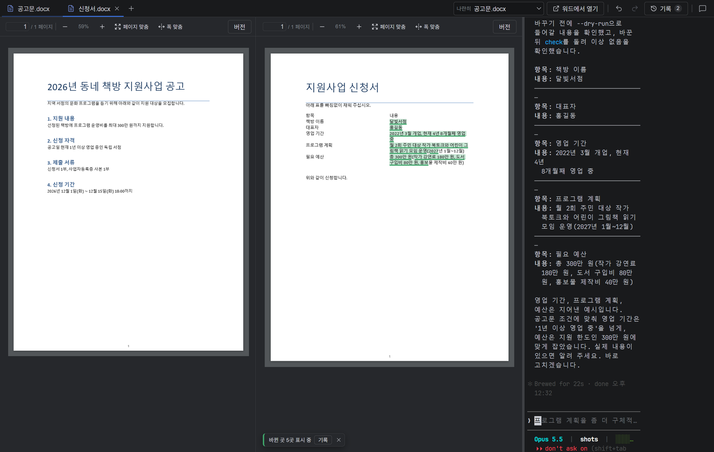

# 별독

**한글·워드 문서를 띄워 놓고, 옆에 있는 Claude 에게 말로 고치게 하는 프로그램.**

## 이런 일에 쓴다

- 공고문을 옆에 띄워 놓고 신청서 표를 채운다.
- 「사업 목적 문단을 반으로 줄여 줘」, 「2쪽 표에 담당자 행을 하나 더 넣어 줘」처럼 말로 고친다.
- 여러 번 고쳐 본 뒤 마음에 드는 판으로 돌아간다.

## 특징

| | |
|---|---|
| **한글·워드가 없어도 된다** | hwpx·docx 를 자체로 그리고 고친다. 한컴오피스·Microsoft 365 구독이 없어도 된다. pdf 는 보기만 한다. |
| **집어서 시킨다** | 문서에서 문단·표를 눌러 고르면 그 위치가 Claude 에게 정확히 넘어간다. |
| **바뀐 곳이 보인다** | Claude 가 고친 글자에 바로 초록 밑줄이 칠해진다. 기록 창에서 무엇이 어떻게 바뀌었는지 본다. |
| **언제든 되돌린다** | 되돌리기·다시 실행(Ctrl+Z·Ctrl+Y), 판 목록, 원하는 판으로 복원, 변경 하나만 되돌리기. |
| **문서 서식은 그대로** | 글자만 바꾸고 글꼴·표 모양·쪽 설정은 건드리지 않는다. |
| **나란히 보기** | 참고 문서를 왼쪽에 띄워 두고 고칠 문서를 고친다. Claude 는 참고 문서를 읽기만 한다. |
| **스스로 새 버전** | 새 버전이 나오면 앱 안에 설치 단추가 뜬다. |
| **앱 안에서 의견 보내기** | 말풍선 단추로 버그·제안을 바로 보낸다. 계정이 없어도 된다. |

## 받기

[**최신 버전 받기**](https://github.com/stellarvision-dev/stellardoc-releases/releases/latest) — `stellardoc_<버전>_x64-setup.exe` 를 받아 실행한다.

> **1.0.0 을 쓰고 있다면** 앱 안의 자동 업데이트로는 1.0.1 을 받을 수 없다. 위 링크에서 설치 파일을 받아 한 번 직접 설치한다. 문서와 설정은 그대로 남고, 그다음 버전부터는 다시 자동으로 업데이트된다.

- Windows 10·11 (64비트)
- [Claude Code](https://claude.com/claude-code) 가 깔려 있고 로그인돼 있어야 한다.
- 관리자 권한 없이 사용자 폴더에 깔린다.
- 아직 코드 서명이 없어 「Windows의 PC 보호」 창이 뜰 수 있다. 「추가 정보 → 실행」을 누른다.

## 설명서

- [설치 안내](docs/install.md)
- [사용 설명서](docs/manual.md)

문서를 읽고 고칠 때 그 내용이 Claude(Anthropic)로 보내진다. 밖으로 보내면 안 되는 문서는 열지 않는다.
이 저장소에는 설치 파일과 설명서만 있다. 소스는 공개하지 않는다.
