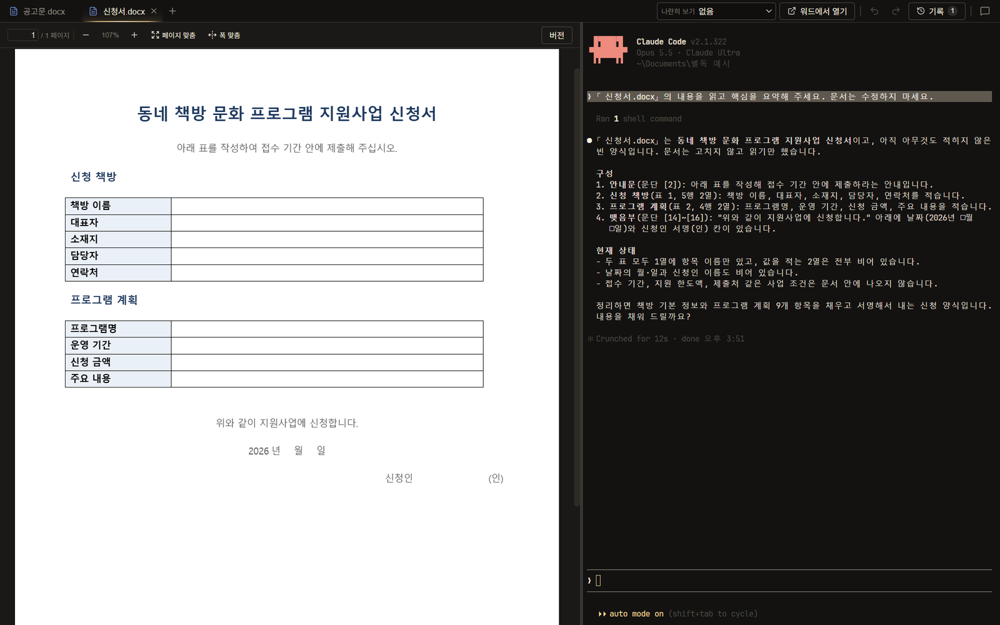
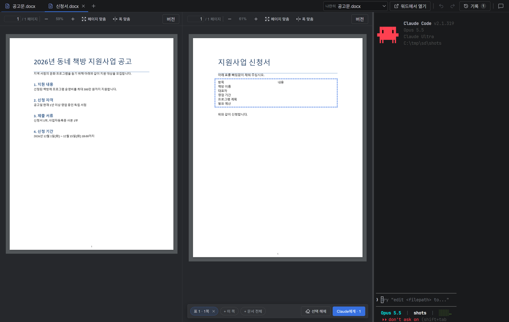
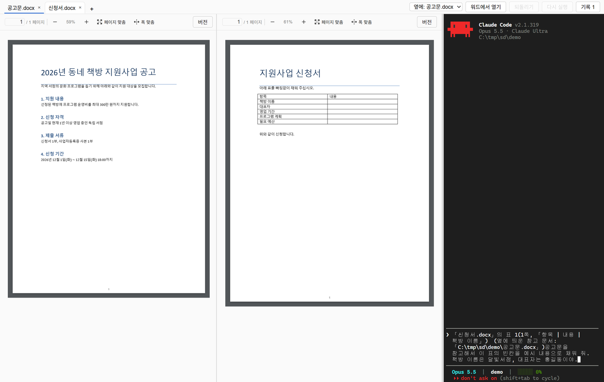
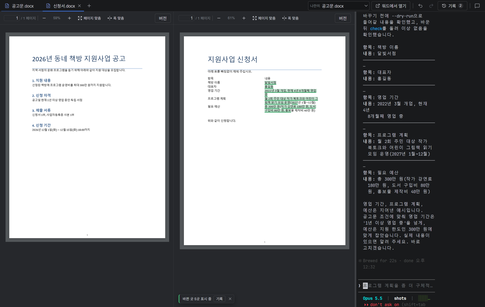
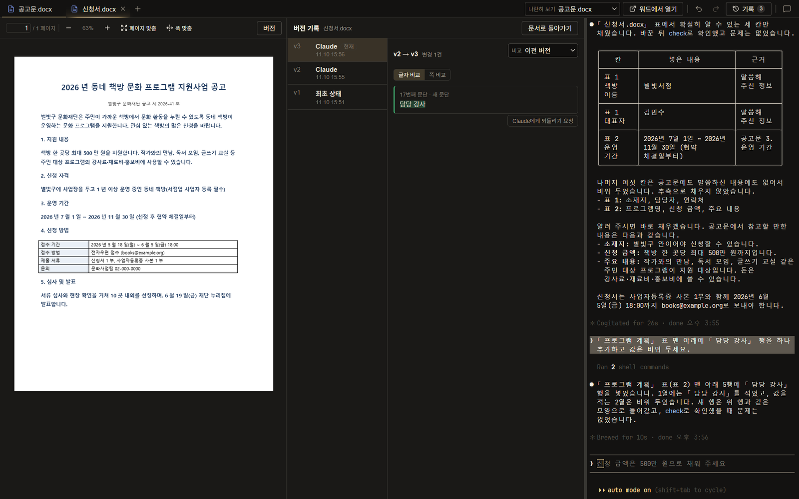
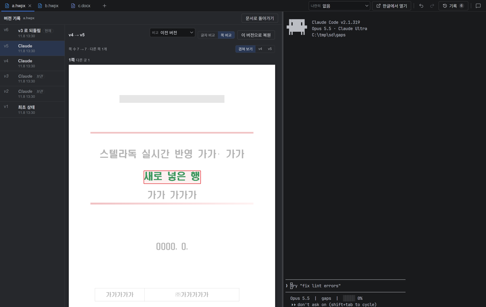

# 별독 사용 설명서

별독은 한글(hwpx)·워드(docx) 문서를 열어 두고, 옆 창의 Claude에게 대화로 수정을 요청하는 프로그램이다.
한글이나 워드가 설치되어 있지 않아도 문서를 표시하고 수정할 수 있다. Claude가 수정한 부분은 문서 위에 바로 표시되며,
언제든 이전 버전으로 되돌릴 수 있다.

설치 방법은 [설치 안내](install.md)를 참고한다.

---

## 1. 화면

| 위치 | 기능 |
|------|---------|
| 위쪽 탭 | 문서마다 탭이 하나씩 생성된다. `+`로 문서를 추가로 연다. `×`나 Ctrl+W로 닫는다. |
| 왼쪽 | 문서. 쪽 번호, 확대·축소, 「페이지 맞춤」「폭 맞춤」이 위에 있다. |
| 오른쪽 | 이 문서를 담당하는 Claude. 문서를 열면 내용을 읽고 먼저 요약한다. 탭마다 Claude가 별도로 연결된다. 가운데 막대를 끌어 폭을 조절한다. |
| 오른쪽 위 | 「나란히 보기」 선택, 「한글에서 열기」·「워드에서 열기」, 되돌리기(↶)·다시 실행(↷) 단추, 「기록 N」, 피드백(말풍선) 단추 |

열 수 있는 파일은 **hwpx · docx · pdf**다. pdf는 보기만 지원한다(Claude와 함께 읽을 수는 있다).
이전 한글 파일 형식(hwp)은 열리지 않는다. 한글에서 「다른 이름으로 저장 → hwpx」로 변환하여 연다.

처음 여는 폴더이면 Claude가 폴더 신뢰 여부를 묻는다. 오른쪽 창을 눌러 응답한다.

## 2. Claude에게 수정 요청하기

오른쪽 창에 요청 내용을 입력하고 Enter를 누른다.

> 2쪽 표의 「담당자」 칸에 김민수를 입력해 주세요.
> 사업 목적 문단을 더 간결하게 다듬어 주세요.

Claude는 문서를 직접 읽고 수정한다. 수정한 내용은 파일에 바로 저장되고 화면이 갱신된다.
글자 모양·표 모양 등 나머지 서식은 그대로 유지된다.

### 수정할 위치를 선택하여 전달하기

위치를 글로 설명하기 어려우면 문서에서 직접 선택한다.

1. 문서에서 문단이나 표를 누른다. 파란 점선으로 표시된다. Ctrl을 누른 채 누르면 여러 개를 선택할 수 있다.
   아래 띠의 「+ 현재 쪽」「+ 문서 전체」로 쪽이나 문서 전체를 선택할 수도 있다.
2. 「Claude에게 · N」을 누르면 선택한 범위가 오른쪽 입력란에 입력된다.
3. 이어서 요청 내용을 입력하고 **Enter는 직접 누른다.** (앱이 대신 전송하지 않는다.)

선택을 해제하려면 「선택 해제」나 Esc를 누른다.

## 3. 다른 문서를 보면서 수정하기 (나란히 보기)

공고문을 보면서 신청서를 작성하는 경우처럼, 참고할 문서를 왼쪽에 표시해 둘 수 있다.

1. 참고할 문서와 수정할 문서를 모두 연다.
2. 수정할 문서 탭을 선택한 뒤, 오른쪽 위 「나란히 보기 없음」을 눌러 목록에서 참고 문서를 선택한다. 다시 「없음」을 선택하면 닫힌다.
3. 왼쪽에 참고 문서, 가운데에 수정할 문서, 오른쪽에 Claude가 배치된다.

이 상태에서 선택한 범위를 Claude에게 전달하면 참고 문서의 위치도 함께 전달된다.
참고 문서에서 문단·표를 선택하여 전달해도 된다. 참고 문서는 Claude가 읽기만 하고 수정하지 않는다.

## 4. 변경 내용 확인

Claude가 수정하면 변경된 글자에 초록 밑줄이 표시되고, 아래에 「변경 N곳 표시 중」이 나타난다.

- 「기록」을 누르면 변경 내용을 목록으로 확인할 수 있다.
- `×`를 누르면 표시만 해제된다(문서는 그대로 유지된다).
- 다른 탭을 보는 동안 해당 문서가 변경되면 탭 이름 옆에 ●가 표시된다. 그 탭을 열면 사라진다.

## 5. 되돌리기와 기록

| 작업 | 방법 |
|--------------|------|
| 직전 버전으로 이동 | 되돌리기 단추(↶) 또는 Ctrl+Z |
| 되돌린 작업을 다시 적용 | 다시 실행 단추(↷) 또는 Ctrl+Y |
| 버전 목록 보기 | 「기록 N」(문서 위 「버전」도 동일) |

Ctrl+Z·Ctrl+Y는 문서 영역을 누른 상태에서 동작한다. 오른쪽 Claude 창 안에서 누르면 Claude 입력란에 적용된다.

기록 창에서는

- 왼쪽에서 버전(v1, v2 …)을 선택하면 해당 버전의 변경 내용이 표시된다. 변경 주체(Claude·외부 변경·되돌림 등)도 함께 표시된다.
- 위 「비교」에서 비교 기준을 정한다. 「이전 버전」「현재 문서」 외에 임의의 버전(v1, v2 …)이나,
  현재 열려 있는 같은 형식의 다른 문서를 선택할 수 있다. 위에 「v1 → v5」「「b.hwpx」 → v5」처럼 비교 대상이 표시된다.
  다른 문서와 비교할 때는 「이 변경 되돌리기」가 표시되지 않는다.
- 「글자 비교」는 변경된 문단·글자를 목록으로, 「쪽 비교」는 두 버전의 쪽 이미지를 겹쳐 변경된 부분에 빨간 상자를 표시한다.
  변경되지 않은 부분은 흐리게 표시되고, 차이가 있는 쪽만 나타난다. 「겹쳐 보기」 옆 버전 번호를 누르면 해당 버전의 쪽만 표시된다.
  (워드 문서는 쪽 비교에서 문서 내 그림 일부가 누락되어 보일 수 있다. 문서 자체에는 영향이 없다.)
- 이전 버전을 선택하면 「이 버전으로 복원」으로 해당 버전 전체를 복원할 수 있다. 복원도 새 버전으로 기록되므로 다시 이전 상태로 돌아갈 수 있다.
- 변경 1건만 되돌리려면 해당 항목 아래 단추를 누른다. 글자를 변경한 항목은 「이 변경 되돌리기」로 바로 되돌린다.
  문단·행을 추가하거나 삭제한 항목에는 「Claude에게 되돌리기 요청」이 표시된다. 누르면 요청 내용이 Claude 입력란에 입력되며, Enter는 직접 누른다.
- 되돌린 뒤에 새로 수정하면, 되돌리기 전에 있던 이후 버전들은 삭제되지 않고 「보관」 표시와 함께 목록에 남는다.
  되돌리기·다시 실행 대상에서는 제외되지만, 선택하여 「이 버전으로 복원」하면 언제든 복원할 수 있다.
- 「문서로 돌아가기」로 닫는다.

버전 기록은 문서 옆 `.sami-versions\<파일 이름>\` 폴더에 저장된다. 프로그램을 종료해도 유지된다.

## 6. 제출 전 확인

별독은 한글·워드 없이 문서를 표시하므로 원래 프로그램과 글자 폭·줄바꿈이 조금 다를 수 있다.
한글이나 워드가 설치된 PC라면 제출하기 전에 「한글에서 열기」·「워드에서 열기」로 한 번 열어 확인한다.

## 7. 새 버전

새 버전이 출시되면 오른쪽 위에 「새 버전 x.y.z 설치」 단추가 표시된다. 누르면 내려받아 설치한 후 다시 시작된다.
이때 열려 있던 Claude 대화도 종료되므로 진행 중인 작업을 마친 후 누른다.

## 8. 피드백 보내기

오른쪽 위 끝의 말풍선 단추를 누르면 「피드백 보내기」 창이 표시된다. GitHub 계정이 없어도 사용할 수 있다.

1. 「버그」「제안」「기타」 중 하나를 선택한다.
2. 내용을 입력한다. 버그라면 수행한 작업과 발생한 현상을 입력한다.
3. 회신을 원하면 연락처(이메일 또는 이름)를 입력한다. 입력하지 않아도 된다.
4. 「보내기」(또는 Ctrl+Enter)를 누른다. Esc를 누르면 닫힌다.

앱 버전과 Windows 버전이 함께 전송된다. 문서 내용은 전송되지 않으므로, 입력란에 문서 내용이나 개인정보를 입력하지 않는다.

## 9. 자주 묻는 질문

**원본 파일이 변경되는가?** 변경된다. Claude가 수정한 내용은 해당 파일에 저장된다. 대신 모든 버전이 기록에 남아 언제든 복원할 수 있다.
원본을 반드시 보존해야 하면 복사본을 열어 작업한다.

**문서 내용이 외부로 전송되는가?** Claude가 문서를 읽을 때 그 내용이 Claude(Anthropic)로 전송된다. 일반 Claude Code를 사용할 때와 같다.
회사 규정상 외부 전송이 금지된 문서는 열지 않는다.

**Claude가 의도와 다르게 수정한 경우.** Ctrl+Z로 되돌리고 더 구체적으로 다시 요청한다. 위치를 직접 선택하여 전달하면 정확도가 높아진다.

**오른쪽 창이 비어 있거나 「터미널을 열 수 없습니다」가 표시되는 경우.** 오른쪽 창의 안내에 따라 Claude Code를 설치하고 「다시 시도」를 누른다. 안내 없이 오류만 표시되면 Claude Code에 로그인되어 있는지 확인한다([설치 안내](install.md)).
